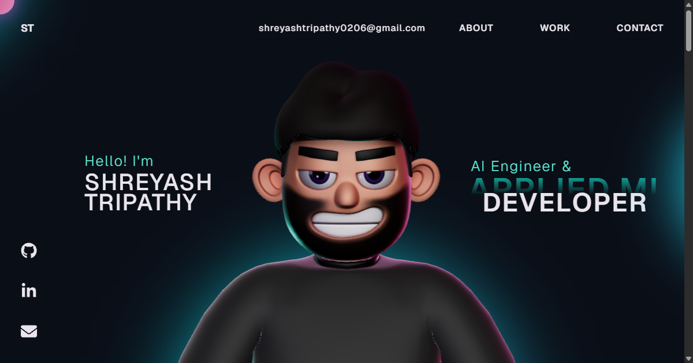

# Shreyash Tripathy — Portfolio

Personal portfolio of Shreyash Tripathy, an AI engineer and applied ML developer. It is an
interactive 3D site built with React, TypeScript, Vite, Three.js, React Three Fiber and GSAP.



## Credits

This site is a customisation of the open-source 3D portfolio template by **Rajesh Chityal**
(MIT License, see [LICENSE](LICENSE)), through the version published at
[akashrmalhotra/3d-portfolio](https://github.com/akashrmalhotra/3d-portfolio). The layout,
animations, scroll choreography and the original 3D character and scene come from that
template.

## What was customised

- **Content:** hero, about, skills, experience timeline, projects, contact and metadata
  (`src/components/`, `src/data/links.ts`, `index.html`).
- **Projects:** the work carousel leads with CHITRADARSHI (PruTech internship) and presents
  each project as problem, contribution, stack and verified outcome, with fact panels in place
  of screenshots. Projects with public source code link to their GitHub repositories.
- **Typography:** headings use [Archivo](https://fonts.google.com/specimen/Archivo) (Omnibus-Type)
  at a condensed width; body text uses [Geist](https://fonts.google.com/specimen/Geist)
  (Vercel). Both are SIL Open Font License 1.1 and load from Google Fonts.
- **Tech-stack spheres:** new textures generated from [Simple Icons](https://simpleicons.org/)
  marks (CC0).
- **3D character:** the original model (`public/models/character.enc`) is unchanged. Clothing
  colours and skin tone are adjusted at runtime. A new hair top and a painted beard are layered
  on as two small assets bound to the existing head bone. See
  [tools/character/README.md](tools/character/README.md).
- **Reliability and accessibility:** the site loads even if the 3D model fails, listeners and
  animation loops are cleaned up, `prefers-reduced-motion` is respected, focus is visible for
  keyboard users, and the heavy physics bundle is loaded after the intro.

## Development

Requires Node.js 18+.

```bash
npm ci
npm run dev      # http://localhost:5173
npm run lint
npm run build    # type-checks, then builds to dist/
npm run preview  # serves the production build
```

## Deployment (Vercel)

The project is a static Vite single-page site. No environment variables are required.

- Framework preset: **Vite**
- Build command: `npm run build`
- Output directory: `dist`

## Resume

The resume button stays hidden until `RESUME_URL` in `src/data/links.ts` points to a PDF in
`public/`. Only publish a version that does not include a phone number.

## License

MIT, see [LICENSE](LICENSE). The original copyright notice is retained.
